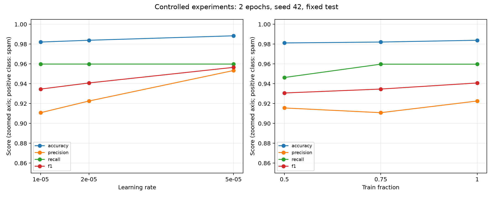

# Экспериментальное исследование и анализ ошибок

Это четвёртая неделя задания; в структуре существующего проекта — Week 10.
Все числа ниже получены запуском `python -m scripts.week10_experiments`.

## Базовая модель и данные

Исходный корпус: `data/SMSSpamCollection`, 5572 SMS; ham=4825, spam=747.
Положительный класс — spam, порог 0.5. Исходное стратифицированное разбиение недели 8:
4457 train / 1115 test, seed=42. Метки и source_row сверены с сохранёнными предсказаниями.
Базовая модель — сохранённый `models/week9_finetuned_bert.pt`: BERT-tiny, 2 эпохи, LR=2e-5.
Повторная оценка checkpoint сверена с `reports/week9_predictions.csv`: максимальное абсолютное
расхождение вероятностей 1.5476638e-06; число несовпадающих классов 0.
Accuracy=0.986547, Precision=0.958904, Recall=0.939597, F1=0.949153.
Ошибок 15: FP=6, FN=9.

## Методика

Пять независимых запусков: LR=1e-5 / 2e-5 / 5e-5 на полном train и 50% / 75% / 100% train при LR=2e-5.
Общий вариант 100%, LR=2e-5 используется в обоих сравнениях, поэтому достаточно пяти обучений.
Каждый запуск начинает с одной закреплённой исходной ревизии `prajjwal1/bert-tiny` (6f75de8b60a9f8a2fdf7b69cbd86d9e64bcb3837), а не с checkpoint, уже видевшего весь train.
Как в неделе 9, голова инициализируется Logistic Regression на замороженных BERT-признаках.
Но она всякий раз обучена только на разрешённой доле train; одинаковая начальная голова используется для всех трёх LR.
Подвыборки вложенные и стратифицированные: 50% входит в 75%, 75% — в 100%; размеры округлены вниз.
Batch=32, 2 эпохи, max_length=96, masked mean pooling включая CLS/SEP, AdamW (weight_decay=0.01),
BCEWithLogitsLoss с положительным весом ham/spam из текущего train, clip_grad_norm=1.
Seed=42, отдельный генератор порядка батчей, CPU, не более четырёх потоков.
Этот порядок батчей зафиксирован явно; новое обучение базовой конфигурации не обязано побитово повторить прежний checkpoint.
Исходные SMS передаются токенизатору BERT без прежнего удаления стоп-слов.
Тест не используется для обучения, подбора порога, числа эпох или остановки.
Это заранее заданное описательное сравнение: максимальный test F1 не является независимой оценкой выбранной модели.
Сокращение train меняет и число шагов оптимизации при фиксированных эпохах; эффект объёма включает это изменение.

## Сводная таблица

| experiment | learning_rate | train_fraction | train_size | accuracy | precision_spam | recall_spam | f1_spam |
| --- | --- | --- | --- | --- | --- | --- | --- |
| week9_saved_reference | 0.000020 | 1.000000 | 4457 | 0.986547 | 0.958904 | 0.939597 | 0.949153 |
| lr_1e-5_full | 0.000010 | 1.000000 | 4457 | 0.982063 | 0.910828 | 0.959732 | 0.934641 |
| lr_2e-5_full | 0.000020 | 1.000000 | 4457 | 0.983857 | 0.922581 | 0.959732 | 0.940789 |
| lr_5e-5_full | 0.000050 | 1.000000 | 4457 | 0.988341 | 0.953333 | 0.959732 | 0.956522 |
| data_50 | 0.000020 | 0.500000 | 2228 | 0.981166 | 0.915584 | 0.946309 | 0.930693 |
| data_75 | 0.000020 | 0.750000 | 3342 | 0.982063 | 0.910828 | 0.959732 | 0.934641 |

Полная точность, длительность, train/test counts и confusion counts — `week10_experiments.csv`.
Сохранённая модель — отдельная строка reference; заново обученная базовая конфигурация — отдельная строка.

## Динамика метрик

На полном train максимальный наблюдаемый F1 среди заданных LR: 5e-05, F1=0.956522.
Это описание данного запуска, а не доказательство универсально лучшего LR.
При 50%, 75% и 100% train получены соответственно F1=0.930693, 0.934641, 0.940789.
Разница 100% − 50%: +0.010096.
Одна реализация seed и одно разбиение не позволяют оценить статистическую устойчивость различий.

## Дубликаты и дополнительная оценка

В корпусе 403 повторных строк по точному тексту сверх первого вхождения.
Между train и test пересекаются 115 уникальных текстов;
128 тестовых строк имеют точное совпадение в полном train.
Основная таблица сохраняет прежний test для сопоставимости. Дополнительно один и тот же фиксированный
набор из 987 тестовых строк без точных совпадений в ПОЛНОМ train оценён для всех моделей:

| experiment | clean_test_size | clean_accuracy | clean_precision_spam | clean_recall_spam | clean_f1_spam |
| --- | --- | --- | --- | --- | --- |
| week9_saved_reference | 987 | 0.985816 | 0.956522 | 0.924370 | 0.940171 |
| lr_1e-5_full | 987 | 0.982776 | 0.911290 | 0.949580 | 0.930041 |
| lr_2e-5_full | 987 | 0.984802 | 0.926230 | 0.949580 | 0.937759 |
| lr_5e-5_full | 987 | 0.987842 | 0.949580 | 0.949580 | 0.949580 |
| data_50 | 987 | 0.981763 | 0.917355 | 0.932773 | 0.925000 |
| data_75 | 987 | 0.983789 | 0.918699 | 0.949580 | 0.933884 |

Этот дополнительный набор исключает точное пересечение текстов, но не гарантирует отсутствие близких шаблонов
и не заменяет внешний корпус. Для следующего исследования нужно отдельное разбиение по группам одинаковых
и близких сообщений до всех этапов обучения. Метрики текущей модели нельзя объявлять проверкой на независимом внешнем корпусе.

## Анализ всех ошибок исходной дообученной модели

Выбраны все 15 ошибок сохранённого checkpoint, а не только удобные примеры.
`week10_errors.csv` содержит исходный текст, source_row, метки, вероятность, FP/FN,
предполагаемую категорию, объяснение и предложенное решение. Полная таблица приведена ниже.
Категории — ручные гипотезы по видимому тексту; причинность не проверена.
Неоднозначность метки не означает доказанную ошибку разметчика. Исходные метки сохранены.

| source_row | message | label | predicted_label | probability_spam | category_hypothesis | reason_hypothesis | proposed_solution |
| --- | --- | --- | --- | --- | --- | --- | --- |
| 5 | FreeMsg Hey there darling it's been 3 week's now and no word back! I'd like some fun you up for it still? Tb ok! XxX std chgs to send, £1.50 to rcv | spam | ham | 0.085034 | Неоднозначный контекст | Реклама платного сервиса оформлена как личное сообщение; указана цена £1.50. | Добавить в train подобные замаскированные рекламные SMS; сохранить цены и сокращения. |
| 1086 | FR'NDSHIP is like a needle of a clock. Though V r in d same clock, V r nt able 2 met. Evn if V meet,itz only 4few seconds. Bt V alwys stay conected. Gud 9t;-) | ham | spam | 0.678856 | Нестандартное написание | Поздравительный текст содержит FR'NDSHIP, V, nt, 4few; причина ошибки предположительная. | Добавить размеченные личные SMS с сокращениями; проверить символьные признаки. |
| 5449 | Latest News! Police station toilet stolen, cops have nothing to go on! | spam | ham | 0.009049 | Неоднозначность разметки | По видимому тексту это короткая шутка; контекст рассылки отсутствует, метка spam требует проверки. | Проверить происхождение сообщения и правила разметки; не менять метку без подтверждения. |
| 263 | MY NO. IN LUTON 0125698789 RING ME IF UR AROUND! H* | ham | spam | 0.986891 | Признаки, похожие на спам | Личное сообщение содержит номер телефона и верхний регистр. | Добавить обычные SMS с телефонами и верхним регистром как трудные отрицательные примеры. |
| 1430 | For sale - arsenal dartboard. Good condition but no doubles or trebles! | spam | ham | 0.000036 | Неоднозначный контекст | Объявление For sale заканчивается шуткой; из одного текста намерение отправителя неясно. | Собрать дополнительные размеченные объявления и шутки; проверить контекст источника. |
| 1266 | Im in inperialmusic listening2the weirdest track ever by”leafcutter john”-sounds like insects being molested&someone plumbing,remixed by evil men on acid! | ham | spam | 0.921962 | Нестандартное написание | Личное сообщение содержит слитные слова, сокращения и необычные символы. | Проверить нормализацию кодировки; добавить примеры с неформальным написанием. |
| 5046 | We have sent JD for Customer Service cum Accounts Executive to ur mail id, For details contact us | ham | spam | 0.773057 | Признаки, похожие на спам | Деловое сообщение использует Customer Service, mail id и contact us. | Добавить легитимные рабочие и сервисные сообщения как трудные отрицательные примеры. |
| 2804 | FreeMsg>FAV XMAS TONES!Reply REAL | spam | ham | 0.431650 | Короткое сообщение | Короткая реклама мелодий содержит FreeMsg и Reply; информации мало. | Добавить короткие рекламные сообщения и проверить ошибки по длине текста. |
| 3539 | We are pleased to inform that your application for Airtel Broadband is processed successfully. Your installation will happen within 3 days. | ham | spam | 0.591461 | Признаки, похожие на спам | Уведомление об установке интернета похоже на массовую сервисную рассылку. | Разграничить транзакционные уведомления и нежелательную рекламу в инструкции разметки. |
| 2823 | ROMCAPspam Everyone around should be responding well to your presence since you are so warm and outgoing. You are bringing in a real breath of sunshine. | spam | ham | 0.021836 | Неоднозначный контекст | Сообщение с префиксом ROMCAPspam выглядит как гороскоп или личное пожелание. | Проверить служебный префикс и происхождение; добавить примеры некоммерческого спама. |
| 751 | Do you realize that in about 40 years, we'll have thousands of old ladies running around with tattoos? | spam | ham | 0.000220 | Неоднозначность разметки | Шутка не содержит явного предложения; без контекста нельзя подтвердить причину метки spam. | Проверить правила для массовых шуток и цепочных сообщений, сохранив исходную метку. |
| 3094 | staff.science.nus.edu.sg/~phyhcmk/teaching/pc1323 | ham | spam | 0.966272 | Короткое сообщение | Сообщение состоит из URL учебной страницы; URL сам по себе не определяет класс. | Добавить легитимные ссылки и рекламные ссылки; проверить признаки домена и контекста. |
| 3302 | RCT' THNQ Adrian for U text. Rgds Vatian | spam | ham | 0.116986 | Нестандартное написание | Короткий ответ с RCT, THNQ и именами выглядит как личная переписка. | Проверить источник и разметку; добавить спам без типичных рекламных слов. |
| 2247 | Hi ya babe x u 4goten bout me?' scammers getting smart..Though this is a regular vodafone no, if you respond you get further prem rate msg/subscription. Other nos used also. Beware! | spam | ham | 0.017818 | Неоднозначный контекст | Текст содержит предупреждение о мошенничестве и цитату приманки; текущая метка spam требует контекста. | Проверить, размечается ли предупреждение или сама рассылка; дополнить инструкцию. |
| 1507 | Thanks for the Vote. Now sing along with the stars with Karaoke on your mobile. For a FREE link just reply with SING now. | spam | ham | 0.469288 | Неоднозначный контекст | Реклама караоке начинается с благодарности за голосование и содержит FREE и reply. | Добавить рекламные сообщения с нейтральным вступлением; проверить достаточно ли контекстных примеров. |

### Группы

| category_hypothesis | error_count |
| --- | --- |
| Короткое сообщение | 2 |
| Неоднозначность разметки | 2 |
| Неоднозначный контекст | 5 |
| Нестандартное написание | 3 |
| Признаки, похожие на спам | 3 |

Дисбаланс классов: доля spam=13.41%; это свойство корпуса, а не установленная причина каждого промаха.
Точность всегда предсказывать ham равна 0.866368 на данном test,
поэтому Accuracy рассматривается вместе с Precision/Recall/F1 и матрицей ошибок.
Текущий weighted loss уже учитывает соотношение классов. Эффект иных весов или oversampling здесь не проверялся.

## Предлагаемые улучшения

1. Проверить неоднозначные метки и происхождение сообщений, не исправляя их по догадке.
2. Добавить в обучающий корпус легитимные ссылки, уведомления и личные SMS с телефонами,
   а также рекламу, оформленную как личная переписка. Не переносить тестовые ошибки в train при сохранении текущей оценки.
3. Отдельно проверить влияние SMS-сокращений, кодировки и длины, используя новую размеченную выборку.
4. Подбирать LR, порог и веса классов на validation внутри train; после выбора оценивать на новом независимом test.
5. Повторить эксперименты с несколькими seed и групповым разбиением, чтобы проверить устойчивость наблюдений.

## Воспроизведение и источники

Команда: `python -m scripts.week10_experiments`. Для заранее скачанной той же ревизии:
`python -m scripts.week10_experiments --model-path /path/to/bert-tiny`.
Локальный каталог должен содержать исходные config.json, vocab.txt, pytorch_model.bin именно указанной ревизии.
Конфигурация, SHA256 исходных данных/checkpoint, версии библиотек и время запуска — `week10_config.json`.
Разбиение и принадлежность подвыборкам — `week10_split.csv`; все вероятности — `week10_predictions.csv`;
потери по эпохам — `week10_training_history.csv`; метрики по обоим классам — `week10_classification_reports.json`.
Входы: исходный корпус, checkpoint и результаты Week 9; новый код: `scripts/week10_experiments.py`.
