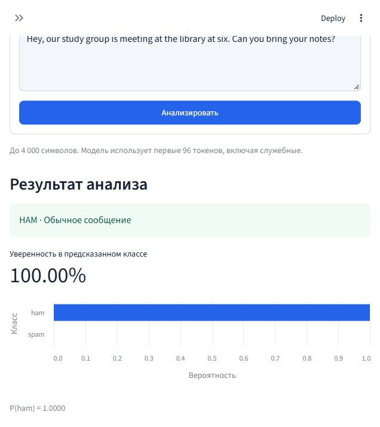
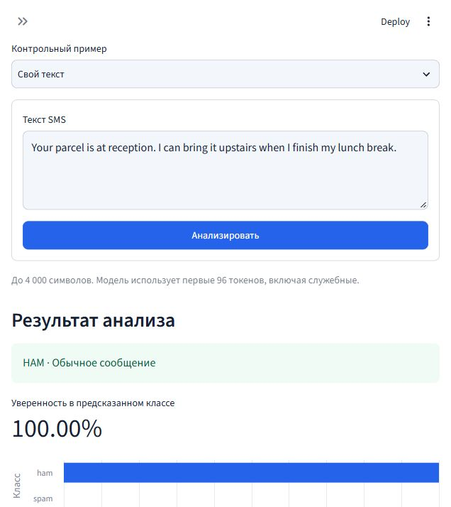
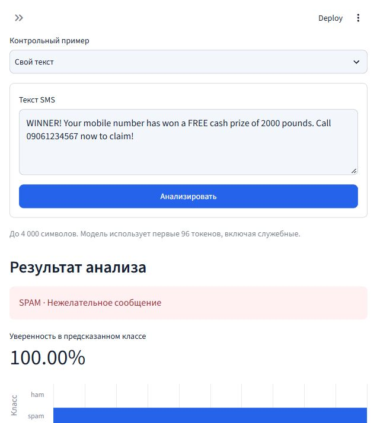
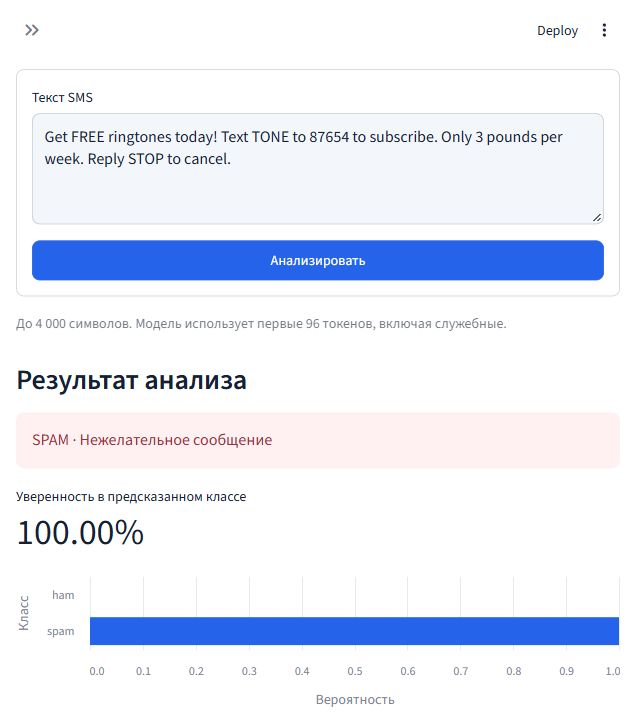
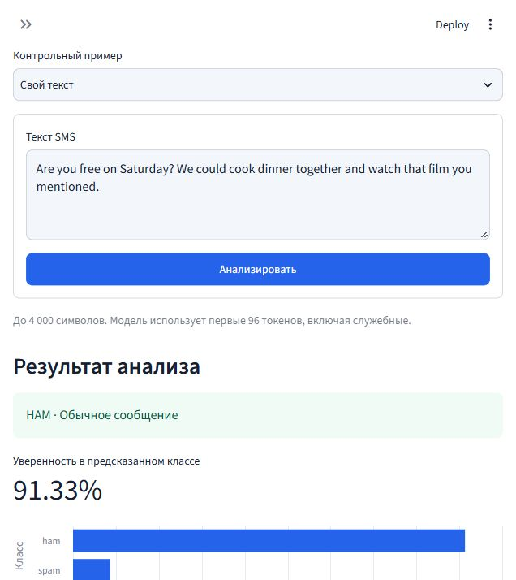

# Неделя 5. Пользовательское NLP-приложение

## Результат

Создано приложение **Streamlit** (`app.py`) для классификации английских SMS на
**ham** (обычная переписка) и **spam** (нежелательная рассылка).
Это Week 11 в нумерации исходного репозитория: предшествующие эксперименты
Week 10 являются 4-й неделей задания. Существующий этап word embeddings Week 5 сохранён.

## Выбор и воспроизведение модели

Источник выбора — `reports/week10_experiments.csv`. Из шести вариантов выбран
максимальный F1 spam: **lr_5e-5_full**. Это закреплённый
`prajjwal1/bert-tiny`, revision `6f75de8b60a9f8a2fdf7b69cbd86d9e64bcb3837`, LR=5e-5, две эпохи,
batch size 32, seed 42, max_length 96. Используются masked mean pooling и
линейная голова; порог spam — 0,5. Классификатор инициализирован Logistic Regression
на замороженных признаках только train, затем дообучен вместе с encoder.

У победителя отсутствовали сохранённые веса. `python -m scripts.prepare_app_model`
повторяет **только выбранную конфигурацию** через исходную функцию обучения
`run_training`, дополненную необязательным сохранением checkpoint. Отчёты и
метрики Week 10 при этом не перезаписываются, модель Week 9 не используется как замена.

| Метрика | Результат 4-й недели | Воспроизведённая модель приложения |
| --- | ---: | ---: |
| Accuracy | 0.988341 | 0.988341 |
| Precision spam | 0.953333 | 0.953333 |
| Recall spam | 0.959732 | 0.959732 |
| F1 spam | 0.956522 | 0.956522 |

Train/test: 4457/1115, прежнее разбиение сверено.
Совпали классы **1115/1115** тестовых SMS;
максимальная разница вероятности spam — **0.01555204**.
На 987 тестовых SMS без точного совпадения с полным train получен F1
**0.949580**. Полные параметры, контрольные суммы, потери по эпохам
и версии библиотек: `week11_model_reproduction.json`; все новые test-предсказания:
`week11_test_predictions.csv`. Различие LF/CRLF при Git checkout учтено при проверке корпуса.

## Функционал

- Многострочное поле для английского SMS и кнопка «Анализировать».
- Пять встроенных контрольных сообщений, которые заполняют поле ввода.
- Предсказанный класс ham/spam и его вероятность в процентах.
- Горизонтальный график P(ham) и P(spam), числовые значения обеих вероятностей.
- Скачать результат JSON с исходным проанализированным текстом и идентификатором модели.
- Проверки пустого ввода, отсутствия английских букв и предела в 4 000 символов.
- Предупреждение об обрезке при превышении 96 токенов и о смешанном тексте с кириллицей.
- Понятная подсказка, если отсутствуют файлы модели. Веб-интерфейс не запускает обучение.
- Модель кешируется между запросами и после подготовки загружается исключительно локально.

Вероятность выбранного класса: P(spam), если P(spam) ≥ 0,5, иначе 1 − P(spam).
Тексты не записываются приложением на диск и не передаются внешним API;
при запуске на другом сервере браузер отправляет текст этому серверу Streamlit.
Сохранение JSON выполняется пользователем по кнопке. Результат формы относится к
последнему нажатию «Анализировать».

## Пять новых контрольных текстов

Ожидаемые метки заданы вручную до проверки. Тексты не совпадают ни с одной строкой
исходного корпуса без учёта регистра. Для каждого примера выбрана опция в форме
Streamlit, нажата кнопка анализа; UI-результат сверяется с прямым вызовом той же модели.
После этого те же пять текстов проверены в настоящем браузере и сохранены скриншоты.
Пройдено по ожидаемым меткам: **5/5**.

| № | Сценарий | Ожидается | Получено | Уверенность | P(spam) |
| --- | --- | --- | --- | ---: | ---: |
| 01 | Встреча после занятий | ham | ham | 100.00% | 0.000035 |
| 02 | Сообщение о доставке | ham | ham | 100.00% | 0.000000 |
| 03 | Обещание денежного приза | spam | spam | 100.00% | 1.000000 |
| 04 | Платная подписка на мелодии | spam | spam | 100.00% | 0.999997 |
| 05 | Слово free в личной переписке | ham | ham | 91.33% | 0.086679 |

CSV/JSON с полными значениями: `week11_control_tests.csv`, `week11_control_tests.json`.
Это функциональные примеры; пять вручную подобранных SMS не являются надёжной оценкой качества.

## Скриншоты работающего UI

### Тест 01. Встреча после занятий

> Hey, our study group is meeting at the library at six. Can you bring your notes?

Ожидаемый класс: **ham**. Предсказание: **ham**, уверенность 100.00%.



### Тест 02. Сообщение о доставке

> Your parcel is at reception. I can bring it upstairs when I finish my lunch break.

Ожидаемый класс: **ham**. Предсказание: **ham**, уверенность 100.00%.



### Тест 03. Обещание денежного приза

> WINNER! Your mobile number has won a FREE cash prize of 2000 pounds. Call 09061234567 now to claim!

Ожидаемый класс: **spam**. Предсказание: **spam**, уверенность 100.00%.



### Тест 04. Платная подписка на мелодии

> Get FREE ringtones today! Text TONE to 87654 to subscribe. Only 3 pounds per week. Reply STOP to cancel.

Ожидаемый класс: **spam**. Предсказание: **spam**, уверенность 100.00%.



### Тест 05. Слово free в личной переписке

> Are you free on Saturday? We could cook dinner together and watch that film you mentioned.

Ожидаемый класс: **ham**. Предсказание: **ham**, уверенность 91.33%.



## Установка и запуск

Из корня репозитория (Windows PowerShell):

```powershell
python -m venv .venv
.venv\Scripts\python.exe -m pip install -r requirements-app.txt
.venv\Scripts\python.exe -m streamlit run app.py
```

Linux/macOS: используйте `.venv/bin/python`. При отсутствии подготовленных файлов:
`python -m scripts.prepare_app_model`; для той же ревизии из локального каталога:
`python -m scripts.prepare_app_model --model-path artifacts/bert-tiny`.
Подготовленная модель включена в сдачу (`models/week11_best_bert/`).
Проверенное окружение: Python 3.14.7; точные зависимости закреплены
в `requirements-app-lock.txt`. Для иных платформ используйте диапазоны `requirements-app.txt`.

Проверки:

```powershell
.venv\Scripts\python.exe -m scripts.test_app_controls
.venv\Scripts\python.exe -m unittest discover -s tests -v
.venv\Scripts\python.exe -m scripts.build_app_report
```

Тесты покрывают согласованность метрик Week 10, все пять сценариев формы,
расчёт вероятностей и уверенности, очистку устаревшего результата после некорректного
ввода и предупреждение об обрезке. Скриншоты требуют отдельного запуска браузера.

## Ограничения

Модель обучена на английских SMS Spam Collection. Для русского/казахского языка,
других доменов и современных схем спама качество не проверено. Вероятности не
калибровались. Часть исторического test имеет дубликаты в train; выбор лучшей конфигурации
по тому же test не даёт независимой оценки её обобщения. Порог и модель не подбирались
по пяти новым контрольным сообщениям.

## Источники

- [Исходный репозиторий](https://github.com/orisbek/bow), commit `d3127a7a608f8d1fe6e163d0a5e32505379de540`.
- [Streamlit: форма и кнопка анализа](https://docs.streamlit.io/develop/api-reference/execution-flow/st.form_submit_button).
- [Streamlit: кеширование модели](https://docs.streamlit.io/develop/api-reference/caching-and-state/st.cache_resource).
- [Streamlit: AppTest](https://docs.streamlit.io/develop/api-reference/app-testing/st.testing.v1.apptest).
- [Transformers: Auto classes и локальная загрузка](https://huggingface.co/docs/transformers/model_doc/auto).
